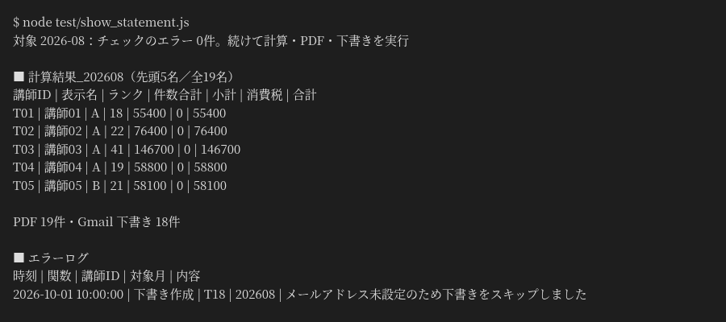

# 講師の月次報酬の計算から、PDF明細と Gmail 下書きまでの自動化（Google Apps Script）

塾や教室で、毎月の実績表から講師ごとの報酬を計算し、明細とメールを1人ずつ作っている事務の方向け。メニューの5つのボタンで、チェック・計算・PDF明細・Gmail 下書き・確定までを順に行います（送信は人が行います）。

上の画像は、Google のサービスを偽物に置き換えた模擬環境で `node test/show_statement.js` を実行したときの実際の出力です（架空の講師20名・2026年8月分、実行日時は 2026-10-01 10:00 日本時間に固定）。本物の Google アカウントでの画面はまだありません。

画像の見方：
- 「消費税」が0なのは、見本の設定（data/settings.csv）の課税区分を「非課税」にしているためです（講師は個人請負という架空の想定）。「課税」にすると消費税率0.1で計算します
- 講師は20名ですが、計算は19名分です。講師19は「無効」の講師なので外しています
- PDFは19件、下書きは18件です。講師18はメールアドレスが未設定のため下書きを作らず、エラーログに理由を残しています

変わること：実績表と単価表を見比べて1人ずつ作っていた計算・明細・メールが、毎月同じ手順のボタン操作でそろい、送る前の確認は下書きの一覧で行えます。

## 課題
毎月、実績の表と単価の表を見比べて講師ごとの報酬を計算し、明細を1人ずつ作って、メールを書いていました。
計算の間違い、作り直し、送る前の確認に時間がかかる作業でした。

## 仕組み
1. 「実績」「マスタ_講師」「マスタ_品目」「設定」のシートを読む（元のデータは書き換えない）
2. ①チェック：足りない値や合わない行を先に洗い出す
3. ②計算：端数処理と税区分を設定どおりに当てて報酬を出す
4. ③PDF作成：講師別の明細をPDFにして保存
5. ④下書き作成：講師ごとの Gmail 下書きを一括で作る（送信は人が行う）
6. ⑤確定：シートを保護し、監査ログを残す
メニュー「月次処理」とサイドバーから、この順に実行します。順番を飛ばしたボタンは押せません。

## 設置の手順
SETUP_GUIDE.md の「1. 初期設定」を参照してください。data/ に架空のサンプルデータ（CSV）があります。

Google上での動作は、data/ の架空のCSVをシートに読み込み、メニュー「月次処理」の①〜④を順に実行して、講師別のPDFがドライブに、下書きが Gmail にできるかで確かめられます。

## 止まるときと記録
- 失敗した処理は「エラーログ」シートに記録し、確定した月は処理しません
- 確定の前に、同じファイル内の非表示シートにバックアップを取ります

## ファイル
| ファイル | 役割 |
|---|---|
| Code.gs | メニューとサイドバーの入口 |
| Config.gs | 設定値・シート名・列番号 |
| Validate.gs・Calculate.gs | チェックと報酬計算 |
| Pdf.gs・Drive.gs | PDF明細と保存 |
| Draft.gs | Gmail 下書きの一括作成 |
| Finalize.gs | 確定とシートの保護・監査ログ |
| Batch.gs・State.gs | 続きからの再開・進み具合と二重処理の記録 |
| Dashboard.gs | 月別の集計とグラフ |
| Util.gs・Sheets.gs | 共通の処理 |
| Sidebar.html | サイドバー |
| test/run.js | Google のサービスを偽物に置き換えた Node.js のテスト（`node test/run.js`、92項目） |
| test/show_statement.js | 架空の2026年8月分で①〜④を通し、計算結果とエラーログを表示する（README の画像の出力） |

## 作りの工夫
- 日付：対象年月や今日の日付は、スクリプトのタイムゾーン（appsscript.json の timeZone。見本では Asia/Tokyo）で読みます。海外の会社で使うときは、この設定を会社の地域に変えてください。
- 6分制限からの再開：Batch.gs の runBatchOverInstructors_ が講師1人ずつ処理し、Config.gs の BATCH_TIME_LIMIT_MS（4.5分）を超えたら進み具合を State.gs の saveBatchProgress_ に残し、scheduleContinuation_ でトリガーを作って resumeBatch から続きを実行する
- 二重処理の防ぎ方：State.gs の getIdempotencyMap_／saveIdempotencyMap_ で、作ったPDF（Pdf.gs）と下書き（Draft.gs）を月ごとに記録し、二度作らない。確定した月は isMonthFinalized_ で止める
- 1日の上限：State.gs の assertDailyLimitNotReached_

## 注意
- 架空のデータの見本です。ここまでの確認は Node.js の模擬環境のテストだけです。実際の運用前に、自分の環境で確かめてください
- Gmail・ドライブ・Apps Script には1日あたりの作成や実行の上限があります

## English summary

A Google Apps Script sample for a tutoring school (fictional, 20 tutors) that goes from monthly pay calculation to a PDF statement and a Gmail draft for each tutor.
It reads the records, tutor and item sheets without changing them, then runs five steps in order from a menu and sidebar: check, calculate, create PDFs, create Gmail drafts, finalize. Drafts are only created; a person sends them. Finalizing protects the sheets and writes an audit log.
Setup: see section 1 of `SETUP_GUIDE.md` (Japanese); fictional CSV data is in `data/`. Tests: `node test/run.js`; `node test/show_statement.js` prints the output shown in the image above. It has been checked with these local tests only.

## 作った人
Reypage｜GAS業務自動化

## ライセンス
MIT（LICENSE を参照）
